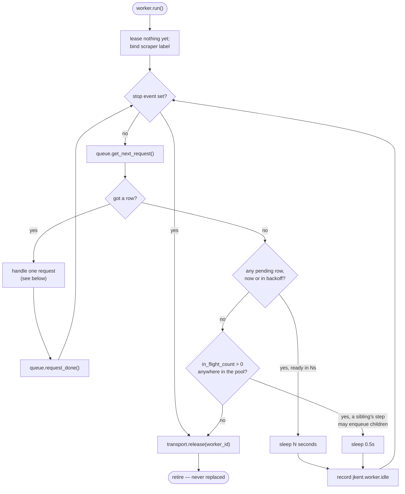
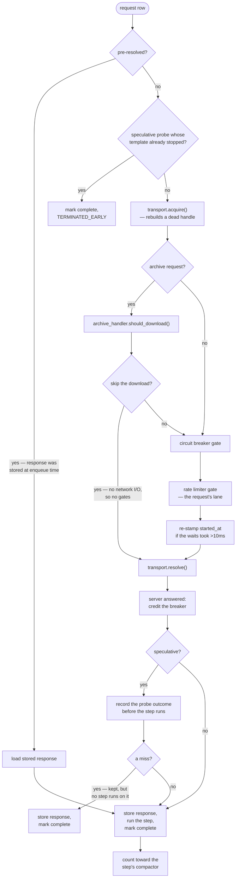

# The worker pool

A run's concurrency is a fixed set of worker tasks over one shared request
queue. The pool is **pinned**: it spawns `num_workers` workers at startup and
never replaces one that exits. A worker retires only when the queue is
*durably* empty — nothing pending, nothing scheduled for a later retry, and
nothing in flight anywhere in the pool — so the pool cannot collapse while
work can still appear.

Everything else on this page follows from that one decision.

## Pool and worker

`WorkerPool` (`jkent/driver/unified_driver/pool.py`) owns the task registry:
spawn, optional staggered ramp, drain, cancel. It knows nothing about
requests. A worker that dies of an exception is capacity the run never gets
back, so the pool logs it loudly and re-raises it out of `drain()`.

`PoolWorker` (`jkent/driver/unified_driver/worker.py`) is the loop. One worker
handles one request at a time, start to finish: lease a transport handle, pull
a row, pass the gates, resolve, persist, run the step. It holds no state
between requests except the three fields describing the request in hand.

## The loop

Two things are worth reading twice.

**The retirement test is conservative on purpose.** A dequeue returning
nothing is not evidence the run is over: the only remaining work may be
retries still inside their backoff window (pending rows with a future
`started_at`, which the dequeue skips), or a sibling may be holding a request
whose step is about to enqueue children. Because a retired worker is never
replaced, the worker retires only when neither can be true.

**`request_done()` is in a `finally`.** The dequeue claims the request as
in-flight; the claim has to be balanced on *every* exit, including a halt or a
cancellation, or idle siblings will wait forever on a request nobody is
handling.

A dequeue that hits a SQLite lock error is not fatal either — the worker rides
it out on a short backoff ladder (0.1s, 0.5s, 2s, 5s) rather than dying over
momentary contention. A lock that outlives the whole ladder propagates.

## One request

The ordering constraints in here are real, not incidental:

- **The archive pre-check is before the gates.** A download the handler
  decides to skip does no network I/O, so it must not spend a rate-limiter
  token.
- **The breaker is before the limiter.** An open circuit must not sit on a
  limiter slot; when it closes, the limiter re-spaces the released workers.
- **The lease is inside the retried region.** A poisoned browser handle shows
  up as a transient failure and is rebuilt by the *next* attempt's `acquire`.
  Transport recovery is invisible to the loop.
- **Speculation is tracked before the step, the compactor after.** The step
  can enqueue further probes.

## Failure routing

Every arm of the request lands in one taxonomy, and the gates hear about it
exactly once, from a single `finally`.

| Raised | Outcome | What the worker does |
| --- | --- | --- |
| `RequestFailedHalt` | `halt` | Propagates. The run stops. |
| `TransientException` | `transient` | Persists whatever the transport saw, schedules a retry, counts `jkent.request.retries`. Out of backoff → fail the row. |
| `SpeculationHTTPFailure` | `speculation_http` | A probe miss, not an error: store the response with its outcome, mark complete, no retry and no step. |
| `PersistentHTTPResponseException` | `persistent_http` | Stores the observed response so the failure is inspectable, then fails the row. No retry. |
| `PersistentException` | `persistent` | A broken scraper assumption. Logs with a traceback — it names the line — and fails the row. |
| anything else | `error` | Logs the exception and fails the row. |

The circuit breaker measures **server availability, not our success**, and the
split falls out of two independent facts: did the site answer at all, and was
the outcome server distress? A 200 whose step then raised an assumption error
still *resets* the breaker — the server is not the thing that broke. Only a
transient counts against it. A skipped archive download and a pre-resolved
request never touched the network, so the breaker hears nothing from either.

The rate limiter hears from the same place, and always from the lane that
gated the request: every classified HTTP failure reaches its own lane with the
status and any `Retry-After`, including the persistent arm — a scraper that
reclassifies 429 as persistent is still being throttled.

## Pinning, and what it costs

A pinned pool buys a stable per-worker resource model. A browser worker leases
one Playwright context for its whole life; the lease is taken once in `run()`
and released in its `finally`. There is no checkout contention, no per-request
context churn, and a worker's identity is stable enough to label metrics and
spans with.

What it costs is elasticity. The pool cannot shrink when a site turns out to
be slower than expected, and it cannot grow when the queue fans out. Pool size
is a startup decision; see [Tune concurrency](../adjustments/tune-concurrency.md).
`ramp_interval` staggers the *spawn* so a run does not open twenty browser
contexts in the same second, but it changes only how fast the pool fills, not
its final size or its pinned-ness.

## Idle accounting

Because the pool is fixed, the question an operator actually has is whether it
is the right size, and the loop answers it directly: every time a worker parks
with nothing dequeuable, it records how long it waited as
`jkent.worker.idle`.

Read it against `jkent.request.duration{phase=total}`:

- **Mostly idle workers** — the pool is oversized for this site's pace. Lower
  `num_workers`; the extra tasks are just polling.
- **Near-zero idle with a growing `jkent.queue.pending`** — the pool is the
  bottleneck. Raise it.
- **Idle falling while `jkent.request.retries` climbs with worker count** —
  that is server pushback, not headroom. The counter-signal against raising
  `num_workers` even when everything else looks like it has room.

`jkent.worker.active` is the live count, republished on every spawn and every
retirement. Against a pinned pool it is a step function: it should rise to
`num_workers` and sit there until the queue drains. Watching it sag mid-run
means workers are dying, which the pool also logs.

## Rejected: a free pool with per-request checkout

The alternative is the usual one — an unbounded set of tasks that check a
transport resource out of a shared pool per request and return it afterward.
It makes elasticity easy and it is what most job runners do.

We did not take it, for three reasons.

**The expensive resource is the browser context, not the task.** Per-request
checkout means a context is shared across unrelated requests, and the
shape of what a context accumulates — cookies, storage, a fingerprint, an
interstitial clearance — is exactly the state a site uses to decide whether to
serve us. Pinning makes that state belong to one worker for the run, which is
the behaviour a real browsing session has.

**Recovery gets harder, not easier.** A worker holding its own handle is the
one that observes the handle dying, at the point of use, and the rebuild is a
retry of its own request. With a shared pool, a poisoned resource is returned
to the pool and poisons the next borrower; you then need health checks,
generation counters, and a quarantine path.

**The signal disappears.** `worker.idle` is only meaningful because the
denominator is fixed. With a free pool there is no "idle worker" to measure —
you would be left inferring saturation from queue depth and latency, which is
a much weaker read on a workload whose fan-out is decided by the pages
themselves.

The cost we accepted in exchange is that pool size is a decision made before
the run, by an operator who may be wrong about the site. That is a knob and a
metric, rather than an architecture.
