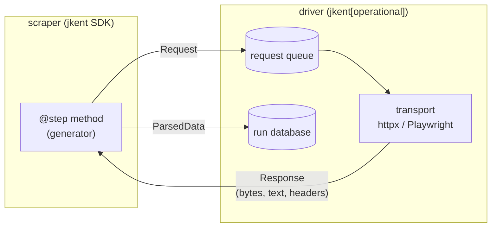

# The scraper/driver split

A scraper is parsing plus navigation *intent*. It never performs I/O. Every
byte that enters a scraper arrives as an argument, and every byte that leaves
it leaves as a yielded value. The driver owns the network, the browser, the
clock, the database and the filesystem.

This is the one architectural decision the rest of the framework is downstream
of, so it is worth being precise about where the line falls and what it buys.

## The shape of the boundary



A step receives an immutable snapshot and returns descriptions of what should
happen next. Nothing in the inbound direction is live: the injectable
parameters a step may declare (`response`, `request`, `text`, `json_content`,
`lxml_tree`, `page`, `local_filepath`, `previous_request`,
`accumulated_data` — see `jkent/common/decorators.py`) are all already-realised
values. Notably `page` is a `PageElement` wrapping a parsed tree, *not* a
Playwright page: even when the response was fetched by a real browser, the
scraper gets a snapshot of the DOM rather than a handle to it. There is no
object in a step's hands that can be awaited.

Outbound, a step yields exactly two kinds of thing (the `ScraperYield` union):
`ParsedData`, which the driver persists, and `Request`, which the driver
enqueues. A `Request` is data — method, URL, params, body, plus the driver's
bookkeeping — and when the next hop is a browser action rather than a URL the
scraper describes the action as a `ViaLink` or `ViaFormSubmit` value for the
transport to perform. See [Declarative navigation](via-and-form-transport.md).

## What a scraper may and may not do

**May:**

- Parse bytes, text, JSON, and HTML.
- Yield `ParsedData` and `Request`.
- Raise an assumption exception when the page is not what it claimed to be
  (see [Why assumptions are exceptions](assumption-exceptions.md)).
- Declare *policy* on its class body: `driver_requirements`, `rate_limits`,
  `named_rate_limits`, `default_headers`, `ssl_context`, `HTTP_CODE_TYPES`.
  These configure I/O; they do not perform it.
- Classify an HTTP status via `classify()`, which the transports consult to
  decide between a response, a retry and a hard failure.

**May not:**

- Open a socket, drive a browser, or touch the filesystem.
- Sleep, retry, or back off. Pacing is the rate limiter's job; retries are the
  request manager's.
- Read or write the run database.
- Hold state across requests in instance attributes. State that must travel
  belongs on the `Request` — its ancestry and `accumulated_data` are how a
  step hands context to its children — because the next step may run in a
  different worker, or in a different process days later after a resume.

## What the split buys

**Testability.** A step is a generator you can call with a hand-built
`Response` and assert on the yields. Scraper tests need no network, no
browser, no event loop and no database; the whole SDK test surface is
synchronous.

**Substitutable transport.** Because the scraper only ever sees a `Response`,
the same scraper runs over httpx or over Playwright/Camoufox. Which one it gets
is decided by the `driver_requirements` it declares, not by code it writes.
Transport parity is then enforceable once, centrally, by a conformance suite
over the transport ABC rather than per scraper — see
[Transports](../../operating/architecture/transports.md).

**Replay.** A transport that answers from a previous run's stored responses
instead of the network is just another transport. The scraper cannot tell the
difference, because there is nothing it could consult to find out. This is what
makes `jent` — the downstream host whose replay transport resolves each
request against a previous run's stored responses by deduplication key —
possible without scraper cooperation.

**Resumability.** The driver's durable state is the request queue plus the
stored responses. Because a step is a pure function of a response, interrupting
a run loses at most the in-flight steps: the queue still holds everything not
yet done, and nothing was hiding in scraper memory. See
[Resumability](../../operating/architecture/resumability.md).

**Dependency isolation.** The split is load-bearing for packaging, not just for
design. `jkent`'s base dependencies are the SDK's only — pydantic, lxml,
cssselect, pyrate-limiter. SQLAlchemy, httpx, Playwright, Camoufox, zstandard
and the OpenTelemetry API all live in the `operational` extra. `jkent/__init__.py`
imports from the `jkent.data_types` facade and never from `jkent.driver`, so
`import jkent` in a parsing-only consumer pulls no driver machinery at all.

## Rejected: scrapers that fetch their own pages

The obvious alternative is the conventional one — give the scraper a session
object and let it call `session.get()`:

```python
# Not how jkent works.
def parse_listing(self, response):
    for row in rows:
        detail = self.session.get(row.href)   # scraper does the I/O
        yield parse_detail(detail)
```

It reads better in the small. What it forecloses:

- **Replay is gone.** There is no seam to substitute. Re-running yesterday's
  bytes against today's parser means intercepting a session object the scraper
  owns — which is monkeypatching, not architecture, and it fails the moment a
  scraper constructs its own client.
- **Concurrency becomes the scraper's problem.** Fan-out, priority, politeness
  and a shared rate-limit budget across the whole run can only be scheduled by
  something that sees all pending work. A scraper that fetches inline has
  already committed to doing the next request *now*.
- **Resume becomes impossible.** Pending work lives in the scraper's call stack
  and local variables, which is not durable state. An interrupted run can only
  restart from the top.
- **Retries land in the wrong place.** The scraper would have to own backoff,
  classification and the circuit breaker, per scraper, instead of once.
- **Tests acquire a network.** Every scraper test becomes an HTTP-mocking
  exercise.

The cost of the chosen design is real and should be named: navigation is
indirect, control flow is inverted, and a sequence that would be four lines of
`await` becomes four steps linked by yielded requests. [The step
model](the-step-model.md) covers how that is written.

## Where the boundary leaks, and how it is policed

The boundary is a convention enforced at the *interface*, not a sandbox.
Nothing stops a step from importing `httpx` and fetching a URL itself; Python
offers no way to prevent it, and jkent does not try.

What does hold it in place:

- **No handle to misuse.** The honest enforcement mechanism is that a step is
  handed nothing live. Doing I/O requires reaching outside the framework
  entirely, which is visible in review as a stray import rather than as a
  plausible use of an injected object.
- **The dependency split.** A scraper package that installs plain `jkent` does
  not have httpx or Playwright available. Fetching requires adding a
  dependency.
- **Import-direction tests.** `tests/test_import_order.py` imports every jkent
  module first in a cold subprocess, which catches a cycle — including one
  introduced by `jkent.common` reaching into `jkent.driver`.

Three places are genuine, deliberate leaks:

- **I/O policy on the class body.** `ssl_context`, `default_headers`,
  `driver_requirements` and `HTTP_CODE_TYPES` are transport concerns declared by
  the scraper, because only the scraper author knows the site. They are
  declarative values the driver reads, never calls the scraper makes — and the
  ones with consequences are validated early: `__init_subclass__` rejects a
  `@step(rate_limit=...)` naming an undeclared lane at class-definition time
  rather than hours into a run, and a `DriverRequirement` with no row in the
  requirements table fails at import.
- **`classify()` is an override point.** A scraper may decide dynamically
  whether a 503 is transient, which means scraper code runs inside the
  transport's error path. It is given headers and content, both of which may be
  `None` or a reconstruction rather than raw wire bytes, so an override has to
  tolerate not knowing.
- **The selector observer.** `Response.observer` is a back-channel the driver
  installs to record which named selectors a step queried. The scraper does not
  read it; it exists so drift reporting does not require scraper cooperation.
  See [Named selectors and observation](selector-contracts.md).
