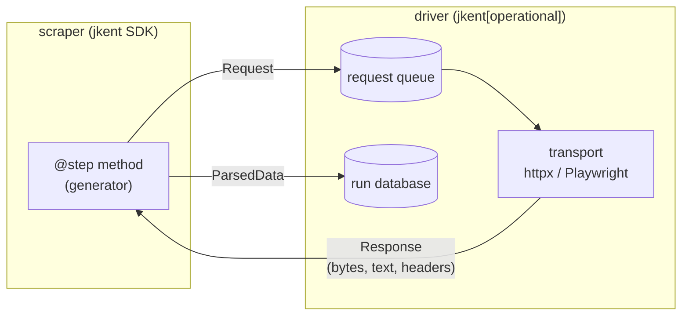

# The scraper/driver split

We split the scraper from the driver to buy operational simplicity.

A scraper is the structure of a website, described from the perspective of its
individual pages. It defines **entry points** — the places we might start
browsing — and **steps**, which are roughly "a type of page on that site." For
each of those pages we care about two things: the data we can get off the page,
and the other places in the site we can reach from it, whether by clicking a
link, submitting a form, or something similar.

So we separate those two. What we can pull out of the page becomes
`ParsedData`. Where we can go next becomes a `Request`. Both are declarative
languages, which means the scraper never has to think about effects at all. The
driver takes care of all of the effects and co-effects: the network, the
browser, the clock, the database, the filesystem.

## The shape of the boundary

A step receives an immutable snapshot and returns descriptions of what should
happen next. Nothing coming in is live: the injectable parameters a step may
declare (`response`, `request`, `text`, `json_content`, `lxml_tree`, `page`,
`local_filepath`, `previous_request`, `accumulated_data` — see
`jkent/common/decorators.py`) are all already-realised values. `page` in
particular is a `PageElement` wrapping a parsed tree, *not* a Playwright page:
even when a real browser fetched the response, the scraper gets a snapshot of
the DOM rather than a handle to it. There is nothing in a step's hands that can
be awaited.

## The yield

Most of the payoff is operational. When a scraper goes down, we can vary
everything the driver is doing that might be causing it, while keeping one
common definition of the site's structure. If a site's SSL cert goes bad, we
run a version of the driver that doesn't care about that — no scraper change.
We can point a driver at an archive of the site we saved earlier and compare it
against fresher results. We can change where we save files, or how we link
pages together in the structure we store them in, without touching the scraper
at all.

It also gives us one uniform way to handle everything a scraper produces. We
don't have to remember the particular columns of each individual parser; we can
inspect the data we're getting in a normalized format and look at it in terms
of its declarative language.

A few more things fall out of it:

- **Testability.** A step is a generator you can call with a hand-built
  `Response` and assert on the yields. No network, no browser, no event loop,
  no database — the whole SDK test surface is synchronous.
- **Substitutable transport.** Because the scraper only ever sees a `Response`,
  the same scraper runs over httpx or over Playwright/Camoufox. Which one it
  gets is decided by the `driver_requirements` it declares, not by code it
  writes. See [Transports](../../operating/architecture/transports.md).
- **Replay.** A transport that answers from a previous run's stored responses
  instead of the network is just another transport, and the scraper cannot tell
  the difference. That's what makes `jent` possible without scraper
  cooperation.
- **Resumability.** The driver's durable state is the request queue plus the
  stored responses. Because a step is a pure function of a response,
  interrupting a run loses at most the in-flight steps. See
  [Resumability](../../operating/architecture/resumability.md).
- **Dependency isolation.** `jkent`'s base dependencies are the SDK's only —
  pydantic, lxml, cssselect, pyrate-limiter. SQLAlchemy, httpx, Playwright,
  Camoufox, zstandard and the OpenTelemetry API all live in the `operational`
  extra, so `import jkent` in a parsing-only consumer pulls no driver machinery.

## The price

This does come with a few limitations on the scraper's own behavior. We don't
want it doing any effects, and there's not really a way to police that in
Python beyond maybe linting imports — so this is me asking politely.

What we give you instead is a lot of configuration, so that it's easy to
specify the things a driver needs to do and the requirements we've observed
about a site: `driver_requirements`, `rate_limits`, `named_rate_limits`,
`default_headers`, `ssl_context`, `HTTP_CODE_TYPES`, and `classify()` for
deciding what an HTTP status means. These are declarative values the driver
reads. The driver is then free to honor those requirements and do anything else
it likes.

Navigation is also indirect, and control flow is inverted. This may be a little unusual at first, but bear with us and it will be okay.

One more consequence: a scraper can't hold state across requests in instance
attributes. State that has to travel belongs on the `Request` — its ancestry
and `accumulated_data` are how a step hands context to its children — because
the next step may run in a different worker, or in a different process days
later after a resume.

## Via link and via form submit

Being able to specify everything we'll need to do for a website does require a
couple of other abstractions: `ViaLink` and `ViaFormSubmit`. These are
declarative ways of describing how you get from one web page to another, by
clicking links that might be protected by JavaScript or by submitting forms
that we want handled in a standardized fashion across different transports. See
[Declarative navigation](via-and-form-transport.md).

The separation we've done here is fairly similar to the way Scrapy handles
things. We added via link and via form submit on top to smooth over the
differences between the bare-bones, no-browser transport layers like httpx —
and anything we decide to add in the future — and the Playwright-derived ones.
