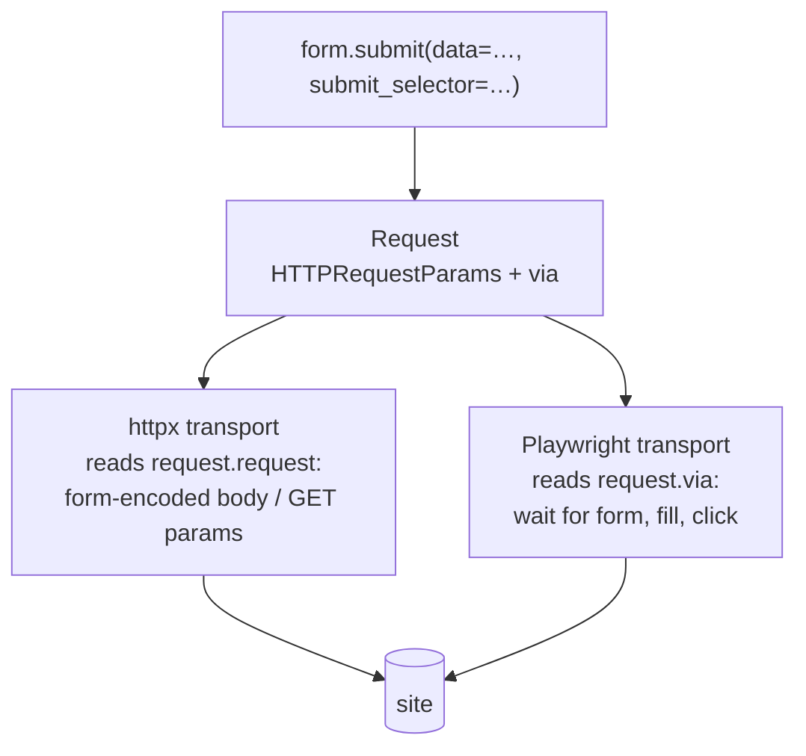

# Declarative navigation

A scraper never builds a POST body. It finds a form, says which values to
change, and yields the result:

```python
form = tree.find_form(CSS("form#search"), "case search form")
yield form.submit(
    data={"docket_number": "A10", "year": "2026"},
    submit_selector=CSS('input[value="Search"]'),
    step="parse_results",
)
```

`form.submit()` returns a `Request` — and that request carries a **via**: a
`ViaFormSubmit` value recording the form selector, the submit selector, and
the merged field data. The same holds for links: `link.follow()` attaches a
`ViaLink` carrying the selector that found the `<a>`.

This page is about why navigation is *described* rather than constructed, and
how the two transports are held to the same behaviour.

## The problem: a hand-built POST and a real submission disagree

Writing the request by hand looks simple, and is simple, right up to the point
where the form has any of the following — all of which are routine on court
sites:

- Hidden fields the server requires (`__VIEWSTATE`, `__EVENTVALIDATION`,
  CSRF tokens) that must be echoed back exactly as rendered.
- Several submit buttons, where the server branches on *which* one was
  activated. A browser submits only the activated control's name/value; a
  hand-built body that includes all of them, or the wrong one, takes a
  different code path on the server.
- Checkbox groups and multi-selects, which submit a repeated key — and whose
  repeats a browser emits in document order.
- Several distinct controls sharing one name, which must all be submitted, in
  document order, with their repeats intact.
- Disabled controls, which a browser does not submit at all.
- An ASP.NET `__doPostBack`, where submission is JavaScript calling
  `form.submit()` with `__EVENTTARGET` set.

Every one of those is a rule about *what a browser would have sent*. A scraper
author reconstructing the body has to know all of them, per site, and will get
some of them wrong silently — the server answers 200 with the wrong page, and
the parse that follows fails somewhere else entirely, or worse, succeeds
against the wrong content.

Worse, the correct answer differs by transport. Under httpx there is no
browser, so the body has to be reconstructed from the parsed HTML. Under
Playwright there is a real form in a real tab, and the right move is to fill it
and click. If the scraper builds the body, the browser transport has to either
ignore the scraper's work and re-derive the action, or submit a body the page
never produced.

## The via is the one description both transports execute

So the scraper produces neither a body nor a click. It produces a description
of the submission, and each transport realises it in its own terms:



`Form.submit` does the browser-semantics work once, centrally:

- It collects the form's rendered defaults in a single document-order pass,
  accumulating same-named controls into a list so repeats survive.
- It includes **only the activated submit control's** name and value, dropping
  every other submit button — resolving which one from `submit_selector`'s
  id/name/value predicate, falling back to the first control as implicit
  submission does.
- It merges the caller's `data` over those defaults, where a list value means
  repeated keys and a `None` entry keeps that position's rendered default —
  so overriding some of a group's controls does not require restating the rest.
- It routes GET forms into query params and POST forms into the body, and
  stores the merged `field_data` on the via.

`HTTPRequestParams` is then enough for httpx, and the via is enough for
Playwright, and both were derived from the same merge.

The via is also the *persisted* form. It is a frozen pydantic model stored in
the run database's `via_json` column, with each selector serialized as
`{"value": …, "grammar": …}`. `via_from_json` is its single reader and is
strict about that shape — a flat `selector`/`selector_type` pair is rejected
rather than parsed by guessing the grammar from the string's prefix. A via
describes an action already taken, so nothing rewrites one after the fact.
That is what lets a request be re-staged later, by a different process, or by a
host outside a run entirely: `jkent/driver/via_actions.py` is extracted from
the Playwright transport precisely so an inspector replaying a request drives
the identical choreography rather than a copy of it.

One field is deliberately not a plain value: a `field_data` entry may be a
zero-arg async `FieldResolver` that the driver awaits when the request is
enqueued — for a captcha solution fetched from an external service, say.
Serializing a resolver is an error, which is the mechanism enforcing that only
concrete values ever reach the database or a transport. The scraper still
performs no I/O; it hands over a callable and the driver calls it.

## Where the browser path cannot be a literal replay

Filling a real form means Playwright has to reproduce effects that the httpx
path gets for free by just writing a key into a dict. `via_actions.py` carries
the compensations:

- A value the override asks for that **no control carries** — an extra field
  with no rendered control, a checkbox group value no box has, a select value
  no option has — is materialised: a hidden input is appended, or an option
  injected. The HTTP path simply submits the key; the browser path has to make
  the DOM able to submit it.
- Boxes the override *dropped* are actively unchecked. Absence from a dict is
  not absence in a DOM.
- The form's `target` attribute is stripped before submitting, because a
  new-tab submit leaks a tab and hangs the navigation wait on Chromium.
- Submission goes through `requestSubmit(submitter)` when the submitter is a
  real submit or image control, because that is what puts the button's
  name/value in the POST — which is how ASP.NET identifies the event source,
  e.g. which grid row's "Select" was clicked. For anything else, a bare
  `form.submit()` sends the same data, since a submit control re-synthesized as
  a hidden input already carries its name and value as a field.

And one branch whose priority is load-bearing: **an explicit
`submit_selector` wins over `__EVENTTARGET`.** The page's hidden
`__EVENTTARGET` input is harvested into `field_data` (empty) during field
collection, so keying on its mere presence would route a button submit to a
bare `form.submit()` with an empty event target — and the server would
re-render the same page instead of navigating. Only when there is no
`submit_selector` *and* `__EVENTTARGET` is present is it an ASP.NET
`__doPostBack`, which a bare `form.submit()` fires. That ordering is the kind
of thing that is invisible until it silently costs a day, which is the argument
for it living in one function rather than in each transport.

## Transport parity is tested generatively against a real browser

"Both transports submit the same thing" is a claim no amount of hand-written
example tests settles, because the interesting cases are combinatorial —
control kinds × duplicate names × overrides × which button × GET or POST.

So `tests/form_conformance/` generates them. Hypothesis produces a `FormCase`,
from which the rig derives the rendered HTML a server would send, the scraper's
`Form.submit(...)` arguments, and the high-level actions expressing the *same
intent* as a native user. One request then goes through the httpx transport,
the chromium Playwright transport and the camoufox/Firefox transport, and all
three are compared against an **independent vanilla-browser oracle** — raw
Playwright, no jkent form code anywhere in its path — submitting the equivalent
form. An echo server canonicalises each submission so the comparison is on
values, repeated keys, *and* order.

The ground truth is therefore a browser, not jkent's own opinion about what a
browser does. That distinction is the point of the rig: without the oracle it
would only prove the transports agree with each other, which they could do
while both being wrong.

The suite is a baseline plus isolated probes, one behaviour each, so a failure
attributes cleanly rather than pointing at "forms":

| Probe | Behaviour pinned |
|---|---|
| `test_happy_path_matches_browser` | values, repeated keys and order on POST forms |
| `test_field_order_matches_browser` | submitted-field document order across control types |
| `test_repeated_get_params_match_browser` | a GET key submitted more than once |
| `test_duplicate_names_match_browser` | several distinct controls sharing one name |
| `test_duplicate_fill_matches_browser` | positional list overrides with `None` keeping defaults |
| `test_group_overrides_match_browser` | radio/checkbox group overrides, including unchecking and injection |
| `test_select_overrides_match_browser` | `<select>` overrides, including injecting a missing option |
| `test_disabled_fields_not_submitted` | disabled controls are not submitted |
| `test_extra_fields_reach_server` | fields with no rendered control still arrive |
| `test_multiple_submit_buttons` | only the activated submit's name/value is sent |

Browsers are slow, so the harness opens the echo server, the database, all
three transports and the oracle **once** and reuses them across every example,
driven from a single persistent event loop. A transport that cannot launch in
the environment is skipped and recorded; if the oracle browser itself cannot
launch, there is no ground truth and the module skips entirely rather than
pretending to verify something.

## Rejected: author-built POST bodies

The alternative is to let the scraper write `HTTPRequestParams(data={...})`
itself. It is still *possible* — nothing prevents a scraper from constructing a
request by hand, and for a simple GET endpoint that is the right thing to do.
What is rejected is making it the way forms are handled.

- **Browser semantics would be re-derived per scraper.** Activated-submit-only,
  document order, disabled skipping, repeated keys: every author would
  reimplement some subset, mostly correctly.
- **The browser transport would have nothing to execute.** A via is what makes
  a request replayable as an interaction. Without it, running the same scraper
  under Playwright means either submitting a synthetic body into a real page —
  which defeats the reason for using a browser — or the browser transport
  guessing at the action from the URL.
- **There would be nothing to test parity *of*.** Conformance here works
  because one description has two realisations that must agree. Hand-built
  bodies make each scraper its own unverifiable contract with the site.
- **Failures would move.** A wrong hidden field produces a 200 with the wrong
  content, and the resulting error surfaces in a later parse, or not at all.

The cost paid for this is that the scraper must be able to *find* the form, so
a form rendered entirely by JavaScript needs a browser transport before
`find_form` sees anything — and `Form.submit`'s override semantics (positional
lists, `None` for "keep the default") are more to learn than a dict literal.
The cookbook page [Submit a form](../cookbook/submit-a-form.md) covers the
usage; this page is about why it is shaped that way.
